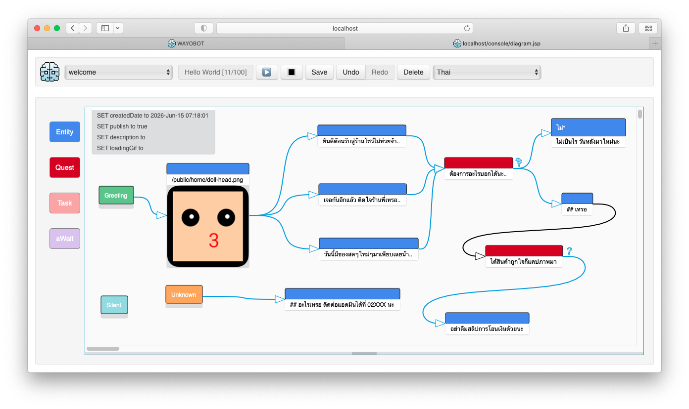
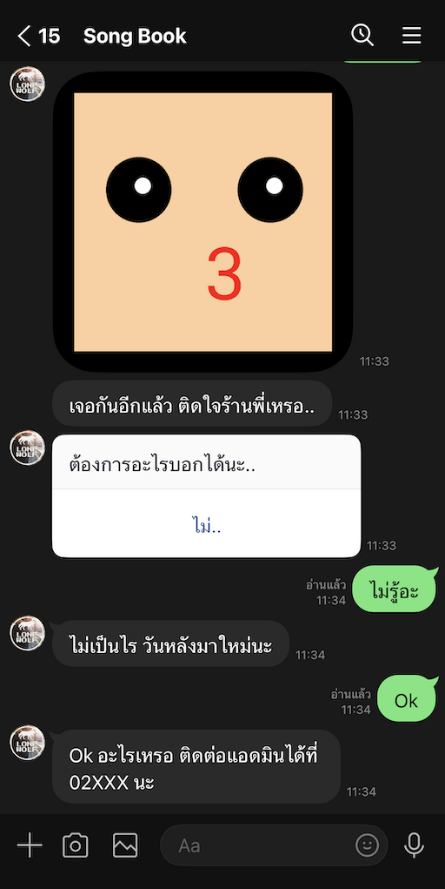

# Wayobot

### A code-less chatbot builder for conversations and interactive stories.



Some things don't need to be complicated.
Wayobot helps you design conversation flows, build chatbots, and create interactive story games — one flow at a time.
No big promises. Just a simple engine that gets the job done.



## What can you build?

- **Chatbots** — Design conversations with flows, conditions, and variables.

- **Business Workflows** — Guide users through FAQs, forms, and step-by-step processes.

- **Story Games** — Create branching stories, choices, and multiple endings.

- **More to come** — Extend your flows and integrate with other services when you need to.

## Getting Started

### Requirements

- Docker

- Docker Compose

Make sure Docker is installed and running on your machine.

### 1. Start Wayobot

From the project directory, run:

```bash
docker compose up -d
```

### 2. Open Wayobot

Open your browser and visit:

[http://localhost](http://localhost)

If you mapped a different port in `docker-compose.yml`, use that port instead.

For example, if your configuration maps port `8080`, visit `http://localhost:8080`.

### 3. Log in to Studio

Use the following demo credentials:

- **Username:** `home`

- **Password:** `demo`

You're ready to explore the Conversation Flow Studio and start building.

### Demo Access

The credentials above are for demo purposes only.
Want to use Wayobot in a real project or production environment?
Please contact the developer to discuss your requirements and get started.
We're happy to help you find the right setup for your needs.

[](https://www.youtube.com/watch?v=pUr6omhJf-M)

**Wayobot — From conversations to adventures. One flow at a time.**

## More Than Chatbots: Stories with a Purpose

A story game isn't just for entertainment.

Businesses can use interactive stories to turn ordinary interactions into engaging experiences.

- **Marketing & Engagement** — Let customers explore products and services through interactive stories.

- **Training & Simulation** — Help employees practice decisions in realistic, risk-free scenarios.

- **Tourism & Experiences** — Create interactive adventures that bring places and brands to life.

- **Product Discovery** — Guide customers toward relevant products through choices and personalized paths.

With Wayobot, you can build branching stories, interactive scenarios, and choice-driven experiences using conversation flows.

No need to build a full-scale game.

Sometimes, a few good choices are enough to tell a story.

[](https://www.youtube.com/shorts/3RH5YCRd5oc)

Start with a simple flow.
Turn it into a conversation.
Turn that conversation into an experience.
You don't have to build everything at once.

## Optional: Connect Wayobot to LINE Using ngrok

If you want to connect Wayobot to the LINE Messaging API while running it locally, you can use ngrok to expose your local web server through a public HTTPS URL.

### 1. Create a Docker Compose File

Create a `docker-compose.yml` file with the following configuration:

```yaml
services:
  ngrok:
    image: ngrok/ngrok:latest
    container_name: my-ngrok
    restart: unless-stopped

    command:
      - http
      - host.docker.internal:80

    environment:
      NGROK_AUTHTOKEN: ${NGROK_AUTHTOKEN}

    ports:
      - "4040:4040"
```

Create a `.env` file in the same directory:

```dotenv
NGROK_AUTHTOKEN=your-ngrok-authtoken
```

Replace `your-ngrok-authtoken` with your authtoken from the [ngrok dashboard](https://dashboard.ngrok.com/get-started/your-authtoken).

Keep your `.env` file private and do not commit it to GitHub.

This configuration forwards public traffic to port `80` on your host machine. Make sure Wayobot is accessible at `http://localhost:80`.

### 2. Start ngrok

Run the following command in the directory containing `docker-compose.yml`:

```bash
docker compose up -d
```

### 3. Configure Wayobot's Public URL

After starting ngrok, obtain the public HTTPS URL from [http://localhost:4040](http://localhost:4040).

For example:

```text
https://example.ngrok.app
```

### 4. Configure LINE Credentials in Wayobot Studio

1. Open Wayobot Studio at [https://example.ngrok.app](https://example.ngrok.app).
2. Log in using the demo credentials:
   - **Username:** `home`
   - **Password:** `demo`
3. Navigate to the **LINE** page.
4. Enter your LINE Messaging API credentials:
   - **Channel Access Token**
   - **Channel Secret**
5. Save your configuration.

You can obtain these credentials from your channel settings in the [LINE Developers Console](https://developers.line.biz/console/).

### 5. Configure the LINE Webhook URL

1. In Wayobot Studio, navigate to the **API** page.
2. Copy the API Webhook URL provided by Wayobot.
For example:

```text
https://example.ngrok.app/webhooks/home/welcome
```
3. Open the [LINE Developers Console](https://developers.line.biz/console/) and select your Messaging API channel.
4. Paste the copied URL into the **Webhook URL** field.
5. Save the URL, select **Verify**, and enable **Use webhook**.

Make sure you copy the complete Webhook URL from Wayobot Studio rather than constructing it manually.

### Notes

- The `home` / `demo` credentials are for demonstration purposes only. Do not use them for a production deployment.

**Note:** This setup is intended for local development and testing. Do not expose sensitive services without appropriate security controls.

## Learning Resources & Contact

Want to learn more about Wayobot?

- **Video Tutorials:** Explore the [Wayobot course on SkillLane](https://www.skilllane.com/courses/chatbot-wayobot) for instructional videos and tutorials.
- **Further Information & Inquiries:** Contact [wayobot.oss@gmail.com](mailto:wayobot.oss@gmail.com) for more information, technical inquiries, quotations, or discussions about using Wayobot in your projects.

Whether you're exploring Wayobot for learning, development, or business use, we're happy to hear from you.
